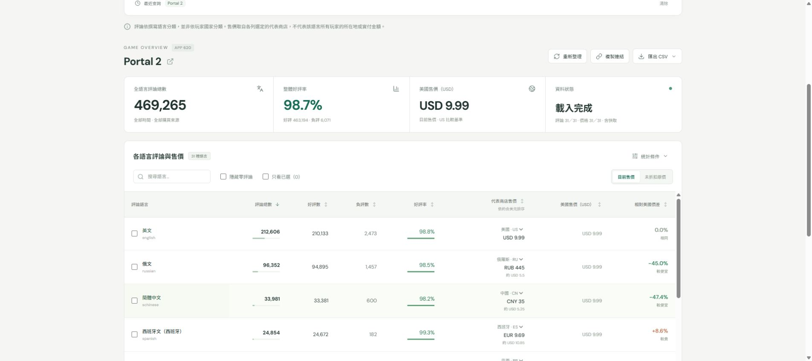

# Steam Lens｜評論語言與區域售價

公開查詢網站：https://steam-review-price-explorer-lendicez.lendicez.chatgpt.site

輸入 Steam App ID 或商店網址，一次查看 31 種評論語言的評論總數、好評數、負評數、好評率，以及可自選代表商店的當地價格、美元換算與相對美國價差。訪客免登入，不需 Steam API Key。

評論依撰寫語言分類，並非玩家國家。代表商店價格不能當成評論者實付價格。



## 使用方式

1. 輸入 `620` 或 `https://store.steampowered.com/app/620/`，按「開始分析」。
2. 等待評論與價格逐列完成；價格失敗不影響已取得的評論。
3. 點欄名排序、搜尋語言、隱藏零評論或勾選只看特定語言。
4. 每列可切換代表商店；右上可切換目前售價與未折扣原價。
5. 「統計條件」可切換購買來源與離題活動口徑。
6. 複製連結可重現查詢條件；CSV 可匯出顯示列或全部語言，包含狀態與資料時間。

## 開發架構

React 19 + TypeScript + Vite/Vinext；API 在 Cloudflare Workers 執行，D1 保存共用快取、快照及跨實例流量控制。採此架構以直接部署可用後端，與原規格的 Express 單一 Node 服務不同。GitHub 保存完整原始碼；公開服務由 Sites 託管，GitHub Pages 不能獨立執行 Steam 查詢後端。

只有本站後端會向 Steam/匯率來源請求。未使用任何第三方 CORS 代理、已棄用的 `/appreviews/`、登入 cookie 或模擬正式資料。

## Windows 11 / PowerShell

安裝 Node.js 22.13 以上與 Git 後：

```powershell
git clone https://github.com/Lendicez/steam-review-price-explorer.git
cd steam-review-price-explorer
npm install
npm run build
node --import ./scripts/sites-env.mjs ./node_modules/wrangler/bin/wrangler.js d1 execute DB --local --config dist/server/wrangler.json --persist-to .wrangler/state --file drizzle/0000_tearful_chronomancer.sql
npm run dev
```

開啟命令列顯示的網址，通常為 `http://localhost:5173`。D1 本機模擬由 Wrangler 提供，不需要 Python、Steam 開發者帳戶或 API Key。

使用 `npm start` 可檢視建置後的 Worker。這不是將網站發佈到雲端。若再次安裝，建議使用專案鎖定的 pnpm（`packageManager` 欄位）；npm 亦可完成安裝，但不讀取 pnpm lockfile。

## 檢查

```powershell
npm test
npm run typecheck
npm run build
npm run probe -- --full
# 在另一個視窗先啟動 npm run dev，再執行瀏覽器測試：
npx playwright install chromium
npm run test:e2e
```

Managed Work 預覽使用 `sites-preview start <專案絕對路徑>`。本次實際驗證及環境限制見 [測試報告](docs/TEST_REPORT.md)。

## 主要檔案

- `app/page.tsx`：繁體中文操作介面、漸進載入、取消、分享、CSV。
- `server/service.ts`：固定來源 API、快取、共用快照、限流與錯誤處理。
- `shared/logic.ts`：摘要驗證、價格單位、十進位換匯、排序及 CSV 防護。
- `shared/config.ts`：版本化語言與可選商店登錄表。
- `db/schema.ts` / `drizzle/`：共用快取及額度資料結構。
- `tests/unit/`：明確人工 fixtures 的計算與解析測試。
- `tests/e2e/`：可在本機重跑的 Playwright 操作測試。
- `scripts/probe.mjs`：真實來源探測；只保存摘要，不保存評論全文及玩家資料。

## 文件

[探測記錄](docs/API_PROBE.md) · [資料來源](docs/DATA_SOURCES.md) · [部署](docs/DEPLOYMENT.md) · [測試](docs/TEST_REPORT.md) · [限制](docs/KNOWN_ISSUES.md) · [原始規格](SPEC.md)

匯率：[Rates By Exchange Rate API](https://www.exchangerate-api.com)。本站非 Valve 官方服務。
